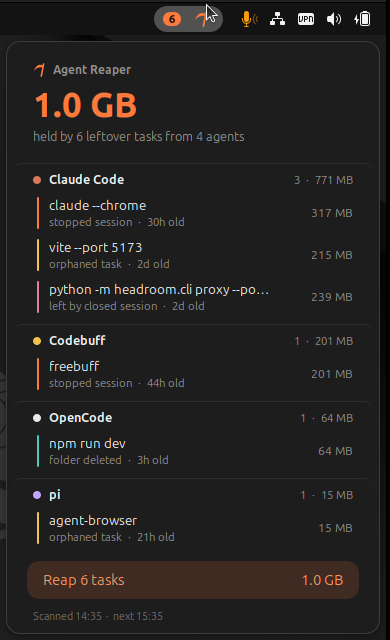

# Agent Reaper

A GNOME Shell extension that finds stale processes left by AI coding agents and
kills them from the top bar.

Agents such as Claude Code, Codex and others start shells, MCP servers and dev
servers. When an agent is stopped or its terminal closes, these processes stay
alive and hold memory and swap. Agent Reaper finds them.



## What it finds

Only leftovers of AI coding agents. A process counts as agent work when its
environment carries the marker its agent sets for every command it runs:

| Agent | Marker |
|---|---|
| Claude Code | `CLAUDECODE`, `CLAUDE_PID` |
| OpenCode | `OPENCODE` |
| Codex | `CODEX_THREAD_ID`, `CODEX_SESSION_ID`, `CODEX_SANDBOX` |
| Gemini CLI | `GEMINI_CLI` |
| Codebuff / Freebuff | `CODEBUFF_LAUNCHER_PID` |
| pi | `PI_CODING_AGENT` |
| Cursor | `CURSOR_AGENT` |
| Antigravity | an `/antigravity` path in its environment |

Of those, it reaps only what is older than one hour and is:

- a stopped agent session whose terminal is gone
- an orphaned task (its parent exited)
- a task left by a closed session (the agent process is gone and the task has no terminal)
- a task whose working folder was deleted
- an agent that holds 3 or more zombie processes

Live sessions and their tasks, tasks in an open terminal, and anything without
an agent marker are never touched. Neither are the session that runs the
scan, browsers, databases, Docker, Ollama, GNOME or the apps in `PROTECT`
in `agent-reaper.py`.

## How it works

- Click the icon: it shows the leftovers grouped by agent, with the reason, age and memory of each.
- **Clean now** kills them: children first, then the parent. It sends SIGTERM,
  waits 5 seconds, then sends SIGKILL to what is left. Each kill is logged to
  `~/.local/state/agent-reaper.log`.
- Every hour it checks in the background and notifies you when new stale
  processes appear. The notification has a **Clean** button.
- The number left of the scythe counts the leftovers. It swipes away when you reap.

## Install

Requires GNOME Shell 46 and Python 3.

```sh
git clone https://github.com/shafiqimtiaz/agent-reaper-gnome-extension.git
ln -s "$PWD/agent-reaper-gnome-extension" \
  ~/.local/share/gnome-shell/extensions/agent-reaper@shafiqimtiaz.github.io
```

Restart GNOME Shell (X11: Alt+F2, `r`, Enter; Wayland: log out and in), then:

```sh
gnome-extensions enable agent-reaper@shafiqimtiaz.github.io
```

## Command line

The script also works on its own. It is a dry run unless you add `--apply`.

```sh
python3 agent-reaper.py              # list stale processes
python3 agent-reaper.py --apply      # kill them
python3 agent-reaper.py --min-age 6h # only older than 6 hours
python3 agent-reaper.py --json       # output for scripts
```

## Tests

```sh
python3 -m unittest test_agent_reaper
```

## License

MIT
